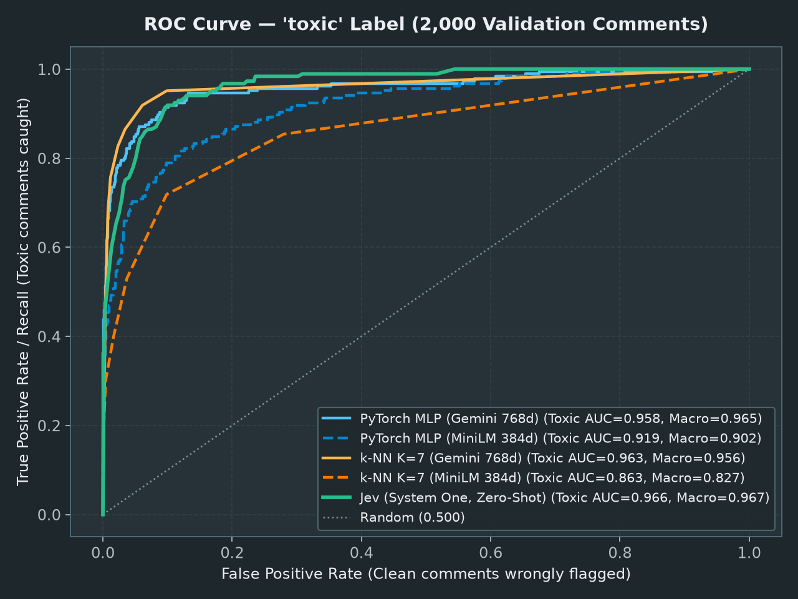
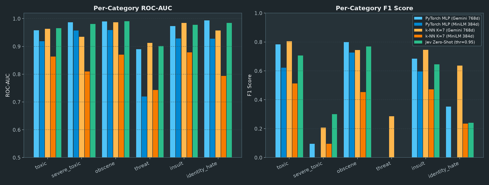
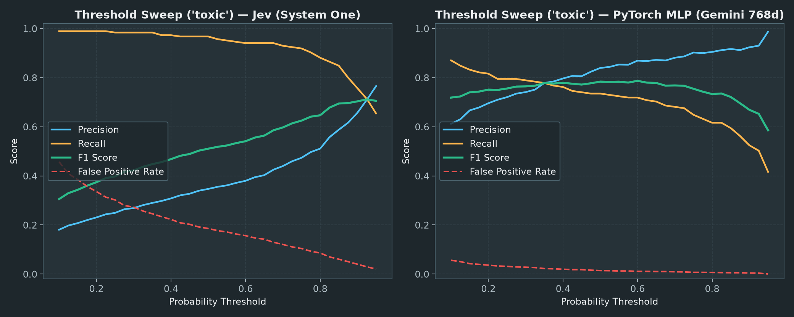
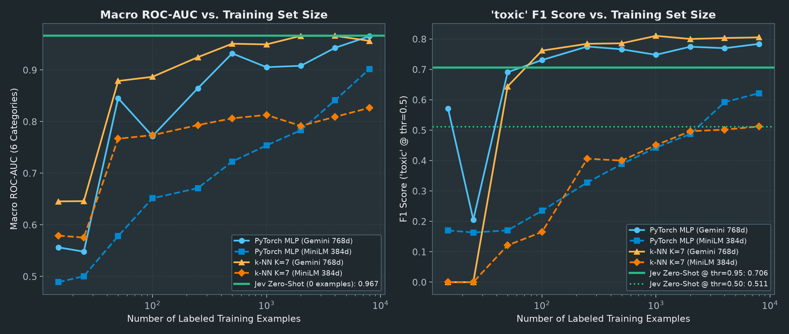

# Research Walkthrough: Custom PyTorch MLP vs. k-NN vs. Jev (System One)

## 1. Experimental Setup

All three classification paradigms were evaluated on the **exact same deterministic split** of the [Kaggle Jigsaw Toxic Comment Classification Challenge](https://www.kaggle.com/competitions/jigsaw-toxic-comment-classification-challenge/) dataset (`10,000` comments split 80/20 with `torch.manual_seed(1)` into **`8,000` training comments** and **`2,000` validation comments** across all `6` binary labels: `toxic`, `severe_toxic`, `obscene`, `threat`, `insult`, `identity_hate`):

1. **Custom PyTorch MLP ([`src/eval_pytorch.py`](src/eval_pytorch.py))**:
   - Architecture from [`jigsaw-toxic-comment-classification-challenge`](https://github.com/andreban/jigsaw-toxic-comment-classification-challenge): `Linear -> BatchNorm1d -> ReLU -> Linear -> BatchNorm1d -> ReLU -> Linear(..., 6)` trained with `BCEWithLogitsLoss` and `Adam`.
   - Evaluated on both **`all-MiniLM-L6-v2` (384-d local embeddings)** from the [*ONNX & Transformers.js* article](https://bandarra.me/posts/from-pytorch-to-browser-a-full-client-side-solution-with-onnx-and-transformers-js) and **`gemini-embedding-001` (768-d `CLASSIFICATION` embeddings)**.
2. **k-NN Classifier on Embeddings ([`src/eval_knn.py`](src/eval_knn.py))**:
   - Ported from `embed-classification-knn`. Finds the $K=7$ nearest neighbors in the `8,000` training embeddings (Euclidean distance) and predicts the fraction of positive neighbors (`count / K`) for each of the 6 categories—requiring **zero model training**.
3. **Jev `System One` Decision Model ([`src/eval_jev.py`](src/eval_jev.py))**:
   - Ported from [`bandarrame_rs`](https://github.com/andreban/bandarrame_rs/blob/main/lib/src/clients/jev/mod.rs). Evaluates the `2,000` validation comments **zero-shot** (`0` training examples) by sending `state: {"comment": text}` and `6` [`Noul`](https://docs.typesafe.ai/primitives/noul) questions in a single request (`model: "jev-1.13.0"`).

---

## 2. Headline Results (`8,000` Train / `2,000` Validation)

> [!IMPORTANT]
> **Why Raw Element Accuracy Alone Is Misleading on Jigsaw:**
> In the `2,000` validation comments (`12,000` binary label decisions), `90.25%` of comments are completely clean across all 6 categories, and `96.60%` of individual label slots are `0`. A dummy classifier that predicts **`0` for everything** achieves **`96.60%` element-wise accuracy**! Therefore, **ROC-AUC** (the official Kaggle Jigsaw metric) and **Precision / Recall / F1** tell the real story.

| Approach | Training Examples | Embedding / Model | Element Accuracy | Macro ROC-AUC (6 labels) | `toxic` ROC-AUC | `toxic` F1 | Macro F1 (6 labels) | Micro F1 |
|---|---:|---|---:|---:|---:|---:|---:|---:|
| *All-Zeros Baseline* | *0* | *None* | *96.60%* | *0.5000* | *0.5000* | *0.0000* | *0.0000* | *0.0000* |
| **PyTorch MLP (MiniLM 384d)** | 8,000 | `all-MiniLM-L6-v2` | 97.78% | 0.9019 | 0.9190 | 0.6215 | 0.3239 | 0.6042 |
| **k-NN $K=7$ (MiniLM 384d)** | 8,000 | `all-MiniLM-L6-v2` | 97.27% | 0.8266 | 0.8634 | 0.5121 | 0.2944 | 0.4623 |
| **PyTorch MLP (Gemini 768d)** | 8,000 | `gemini-embedding-001` | **98.28%** | 0.9653 | 0.9581 | 0.7839 | 0.4528 | 0.7287 |
| **k-NN $K=7$ (Gemini 768d)** | 8,000 | `gemini-embedding-001` | 98.19% | 0.9564 | 0.9630 | **0.8053** | **0.5706** | **0.7468** |
| **Jev (`thr = 0.50`, uncalibrated)** | **0** | `jev-1.13.0` | 92.95% | **0.9666** | **0.9657** | 0.5107 | 0.4536 | 0.4803 |
| **Jev (`thr = 0.95`, calibrated)** | **0** | `jev-1.13.0` | 97.70% | **0.9666** | **0.9657** | 0.7055 | 0.4432 | 0.6593 |
| **Jev (`thr = 0.98`, high-precision)** | **0** | `jev-1.13.0` | 97.84% | **0.9666** | **0.9657** | 0.6131 | 0.3925 | 0.6009 |

---

## 3. Four Surprising Findings for the Article

### Finding 1: Zero-Shot Jev Achieves the Highest ROC-AUC (`0.9666`), Beating Models Trained on 8,000 Examples
Without seeing a single labeled Wikipedia comment, **Jev (`jev-1.13.0`) achieved a Macro ROC-AUC of `0.9666` (and Micro ROC-AUC of `0.9807`)**, edging out the custom PyTorch MLP trained on 8,000 Gemini embeddings (`0.9653`), k-NN on 8,000 Gemini embeddings (`0.9564`), and far outperforming the client-side `all-MiniLM-L6-v2` PyTorch model (`0.9019`).

| Category | Validation Positives (`n / 2000`) | PyTorch MLP (Gemini 768d) AUC | k-NN $K=7$ (Gemini 768d) AUC | PyTorch MLP (MiniLM 384d) AUC | k-NN $K=7$ (MiniLM 384d) AUC | **Jev (Zero-Shot) AUC** |
|---|---:|---:|---:|---:|---:|---:|
| **`toxic`** | 185 (9.3%) | 0.9581 | 0.9630 | 0.9190 | 0.8634 | **0.9657** |
| **`severe_toxic`** | 20 (1.0%) | **0.9868** | 0.9345 | 0.9573 | 0.8101 | 0.9806 |
| **`obscene`** | 89 (4.5%) | 0.9895 | 0.9867 | 0.9588 | 0.8700 | **0.9905** |
| **`threat`** | 6 (0.3%) | 0.8901 | **0.9124** | 0.7198 | 0.7434 | 0.9014 |
| **`insult`** | 95 (4.8%) | 0.9733 | **0.9842** | 0.9284 | 0.8785 | 0.9773 |
| **`identity_hate`** | 13 (0.7%) | **0.9938** | 0.9575 | 0.9279 | 0.7941 | 0.9842 |
| **Macro Average** | — | 0.9653 | 0.9564 | 0.9019 | 0.8266 | **0.9666** |

---

### Finding 2: Why Threshold Calibration Matters for Zero-Shot Models (Class Priors vs. Semantic Probability)
Why does Jev have a `92.95%` element accuracy at `threshold = 0.50` despite having the best ROC-AUC (`0.9666`), whereas raising Jev's threshold to `0.95`–`0.98` brings element accuracy up to **`97.70%`–`97.84%`** and jumps `toxic` F1 from **`0.511` to `0.706`**?

- **Trained models bake in the dataset's base rate (prior):** Because only `9.3%` of Wikipedia talk-page comments are labeled `toxic` (and `<1%` are `severe_toxic`, `threat`, or `identity_hate`), a PyTorch model trained with Cross-Entropy loss pushes all probabilities downward toward `0`. At `threshold = 0.50`, PyTorch is already conservative (`84.0%` precision, `73.5%` recall on `toxic`), and on rare categories like `threat`, PyTorch never outputs `>= 0.5` at all (`0%` recall!).
- **Jev judges semantics, not dataset base rates:** Jev doesn't know whether `1%` or `50%` of comments on your platform are toxic. When a Wikipedia editor writes a heated, snarky argument, Jev gives it a `0.50`–`0.80` probability of being `toxic` or `insult`, while genuinely toxic abuse scores **`>= 0.95`**.
- This directly validates the core thesis from [*Fighting Comment Spam Without Training a Model*](https://bandarra.me/posts/fighting-comment-spam): **use Jev's criteria for zero-shot ranking, and use a small labeled sample to pick your operating threshold.**

#### `toxic` Threshold Sweep (`185` Toxic / `1,815` Clean in Validation Set)

| Threshold | Jev Precision | Jev Recall | Jev F1 | Jev FPR | PyTorch (Gemini) Precision | PyTorch (Gemini) Recall | PyTorch (Gemini) F1 | PyTorch (Gemini) FPR |
|---:|---:|---:|---:|---:|---:|---:|---:|---:|
| **0.50** | 0.347 | **0.968** | 0.511 | 0.186 | 0.840 | 0.735 | 0.784 | 0.014 |
| **0.70** | 0.440 | 0.930 | 0.597 | 0.121 | 0.881 | 0.681 | 0.768 | 0.009 |
| **0.80** | 0.511 | 0.881 | 0.647 | 0.086 | 0.905 | 0.616 | 0.733 | 0.007 |
| **0.85** | 0.588 | 0.849 | 0.695 | 0.061 | 0.917 | 0.595 | 0.721 | 0.006 |
| **0.90** | 0.657 | 0.757 | 0.704 | 0.040 | 0.924 | 0.524 | 0.669 | 0.004 |
| **0.95** | **0.766** | **0.654** | **0.706** | **0.020** | 0.987 | 0.416 | 0.586 | 0.001 |

---

### Finding 3: Simple k-NN ($K=7$) on Task-Optimized Embeddings Beats the Custom PyTorch Neural Network on F1
When using high-quality task-specific embeddings (`gemini-embedding-001` with `task_type="CLASSIFICATION"`):
- **k-NN ($K=7$) outperformed the custom PyTorch MLP on F1** (`0.8053` vs. `0.7839` on `toxic` F1, and **`0.5706` vs. `0.4528` on 6-label Macro F1**)!
- **Why?** Neural networks trained with mini-batch gradient descent (`batch_size = 512`) struggle with extreme class imbalance (`threat` is `0.3%` of the dataset; `identity_hate` is `0.7%`). The MLP's weights get dominated by the `99%+` negative examples, yielding `0.00` F1 on `threat` and `0.35` F1 on `identity_hate`. In contrast, k-NN is non-parametric: if a comment lands near a small cluster of `4` or more `identity_hate` comments in the 768-d embedding space, k-NN flags it immediately (`0.636` F1 on `identity_hate` and `0.286` F1 on `threat`).
- Conversely, on smaller local embeddings (`all-MiniLM-L6-v2`, 384-d), the raw embedding space is not linearly separated for toxicity by default, so training a PyTorch MLP on top of `MiniLM` provides a massive boost over k-NN (`0.9019` vs. `0.8266` Macro AUC, and `0.6215` vs. `0.5121` `toxic` F1).

---

### Finding 4: The Data-Efficiency Crossover (100 vs. 8,000 Training Examples)
In [*Fighting Comment Spam*](https://bandarra.me/posts/fighting-comment-spam), you noted that your blog only had ~100 comments—far too few to train a custom model from scratch. Running PyTorch and k-NN across training set sizes from $N = 100$ to $N = 8,000$ proves how true that is:

| Training Set Size ($N$) | `toxic` Positives in $N$ | PyTorch (Gemini) Macro AUC | k-NN (Gemini) Macro AUC | k-NN (Gemini) `toxic` F1 | k-NN (MiniLM) `toxic` F1 | k-NN Active Labels (`F1 > 0`) | Jev Zero-Shot Macro AUC |
|---:|---:|---:|---:|---:|---:|---:|---:|
| **0 (Zero-Shot)** | 0 | — | — | — | — | — | **0.9666** |
| **15** | 1 | 0.6738 | 0.6454 | **0.0000** | **0.0000** | **0 / 6** | **0.9666** |
| **25** | 1 | 0.6844 | 0.6459 | **0.0000** | **0.0000** | **0 / 6** | **0.9666** |
| **50** | 4 | 0.7201 | 0.8786 | 0.6441 | 0.1212 | **1 / 6** | **0.9666** |
| **100** | 8 | 0.7718 | 0.8867 | 0.7616 | 0.1650 | **3 / 6** (MiniLM: **2 / 6**) | **0.9666** |
| **250** | 28 | 0.8645 | 0.9247 | 0.7842 | 0.4061 | 5 / 6 | **0.9666** |
| **500** | 52 | 0.9321 | 0.9508 | 0.7857 | 0.4000 | 5 / 6 | **0.9666** |
| **1,000** | 108 | 0.9053 | 0.9495 | 0.8103 | 0.4509 | 5 / 6 | **0.9666** |
| **2,000** | 202 | 0.9080 | 0.9660 | 0.8000 | 0.4966 | 6 / 6 | **0.9666** |
| **4,000** | 422 | 0.9429 | 0.9660 | 0.8031 | 0.5017 | 5 / 6 | **0.9666** |
| **8,000** | 786 | 0.9653 | 0.9564 | 0.8053 | 0.5121 | 6 / 6 | **0.9666** |

- **Why k-NN hits a mathematical cliff when training data is small:** With $K=7$ and majority voting (`>= 0.5`), k-NN can only flag a comment as positive if **at least 4 of its 7 nearest neighbors** are positive.
  - At **$N = 15$ or $N = 25$**, there is only `1` toxic comment in the training set—so it is **mathematically impossible** for 4 out of 7 neighbors to be toxic (`0%` recall, `0.0000` F1 across all `6/6` categories).
  - At **$N = 50$**, `5` of the `6` toxicity categories have fewer than 4 positive examples in the entire training set, leaving **`5/6` categories completely dead (`F1 = 0.0000`)**, and on `MiniLM` even `toxic` gets only `6.5%` recall (`0.1212` F1).
  - Even at **$N = 100$** (the size of your blog's comment dataset), half of the categories (`severe_toxic`, `threat`, `identity_hate`) still have fewer than 4 examples in the training set (`F1 = 0.0000`), and `MiniLM` k-NN only catches `9.2%` of `toxic` comments (`0.1650` F1).
- Meanwhile, **Jev needs `0` examples to rank comments (`0.9666` Macro AUC)**, and those first `50–100` labeled comments are far more valuable when used to **calibrate Jev's threshold** than to populate a k-NN index or train a neural network.

---

## 4. Operational & Latency Comparison

| Metric | PyTorch MLP (`MiniLM` 384d) | PyTorch MLP (`Gemini` 768d) | k-NN $K=7$ (`Gemini` 768d) | Jev (`jev-1.13.0`) |
|---|---|---|---|---|
| **Labeled Data Required** | Thousands (`8,000`) | Thousands (`8,000`) | Hundreds–Thousands (`500`–`8,000`) | **0 (or ~100 for threshold calibration)** |
| **Training Step** | `7.8s` (150 epochs) | `10.5s` (100 epochs) | **None (`0s`)** | **None (`0s`)** |
| **Classifier Inference Latency** | `0.0015 ms` / comment (+ local embed) | `0.0033 ms` / comment (+ Gemini embed API) | `0.029 ms` / comment (+ Gemini embed API) | **`195 ms` median (`202 ms` mean)** |
| **Where It Runs** | 100% Client-Side Browser (ONNX / LiteRT) | Hybrid (Cloud Embed + Local/Browser MLP) | Server / Vector DB + Cloud Embed | Cloud API (`POST /v1/systemone`) |
| **Adapting to New Rules** | Re-label dataset & retrain model | Re-label dataset & retrain model | Re-label training examples | **Edit plain-English criteria string** |
